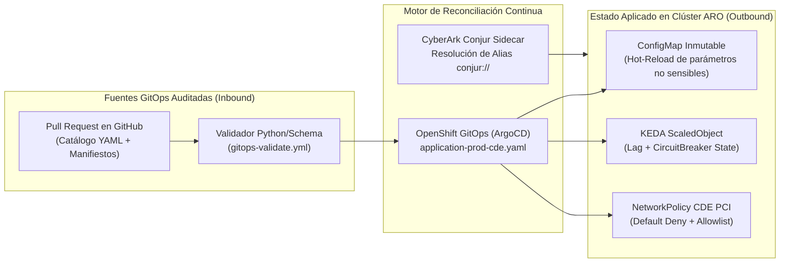
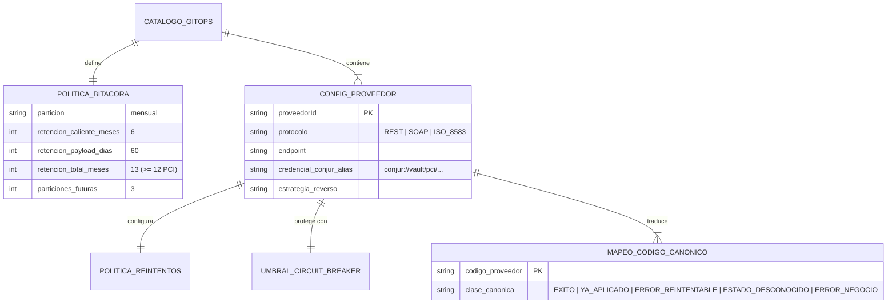
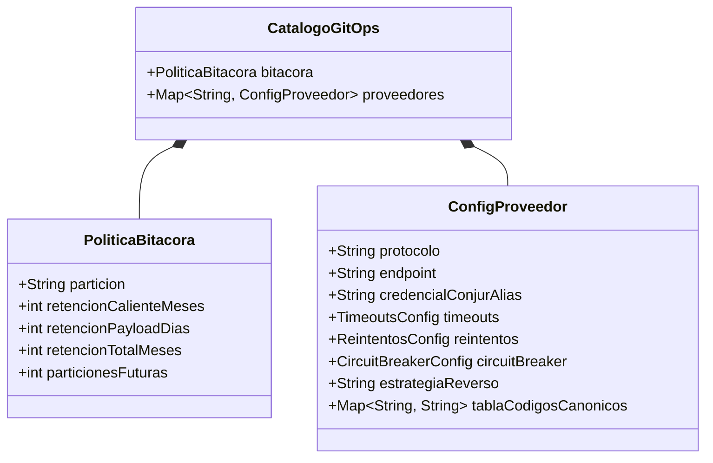
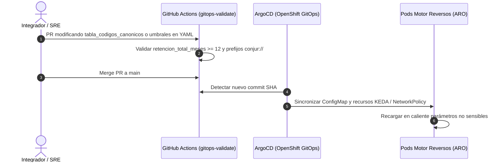

# `xpos-gitops-config-aro` — Gobierno GitOps, Catálogo de Proveedores, KEDA y Aislamiento CDE en ARO

Repositorio de estado deseado para **OpenShift GitOps (ArgoCD)**, configuración declarativa de proveedores externos, escalamiento KEDA consciente del Circuit Breaker (**RT-02**) y políticas de red del entorno PCI-DSS (**P2**).

---

## 1. Especificación Funcional

1. **Catálogo Declarativo de Proveedores (`config/proveedores-y-bitacora.yaml`):** Permite dar de alta proveedores sobre protocolos existentes (`REST`, `SOAP`, `ISO_8583`) o ajustar tablas de mapeo de códigos canónicos, timeouts y umbrales de Circuit Breaker mediante Pull Request auditado en Git, sin recompilar el motor.
2. **Cero Secretos en Git:** El pipeline rechaza cualquier credencial en claro; todos los proveedores referencian sus llaves/certificados mediante URI de **CyberArk Conjur** (`conjur://vault/pci/...`).
3. **Escalado KEDA Health-Aware (`manifests/cde-pci-keda-and-netpol.yaml`):** Combina el lag de Kafka con el estado `closed` del Circuit Breaker para evitar escalar pods cuando el proveedor está caído y el consumidor está pausado.

---

## 2. Especificación Técnica y Diagrama de Arquitectura Hexagonal GitOps



---

## 3. Modelo de Datos de Configuración GitOps (ER Diagram)



---

## 4. Diagrama de Clases de Configuración



---

## 5. Diagrama de Secuencia de Promoción y Recarga GitOps



---

## 6. Códigos de Estado de Validación GitOps

| Código | Regla Validada | Acción del Pipeline |
| :--- | :--- | :--- |
| `GITOPS-VAL-00` | Esquema YAML y restricciones PCI válidas | Permite Merge y sincronización en ArgoCD |
| `GITOPS-ERR-PCI-RET` | `retencion_total_meses < 12` | Bloquea el PR por incumplimiento de PCI-DSS Req 10.7 |
| `GITOPS-ERR-SECRET` | Credencial sin prefijo `conjur://` | Bloquea el PR para impedir secretos en Git |

---

## 7. Runbook Operativo GitOps

1. **Alta de un Proveedor Nuevo con Protocolo Existente (Sin tocar código Java):**
   - Agregar el bloque del proveedor en `config/proveedores-y-bitacora.yaml` con su alias en Conjur y su `tabla_codigos_canonicos`.
   - Abrir Pull Request; una vez aprobado el check `validate-gitops`, hacer merge y verificar el estado `Synced / Healthy` en ArgoCD.
2. **Rollback Inmediato de Configuración:**
   ```bash
   git revert HEAD && git push origin main
   ```
